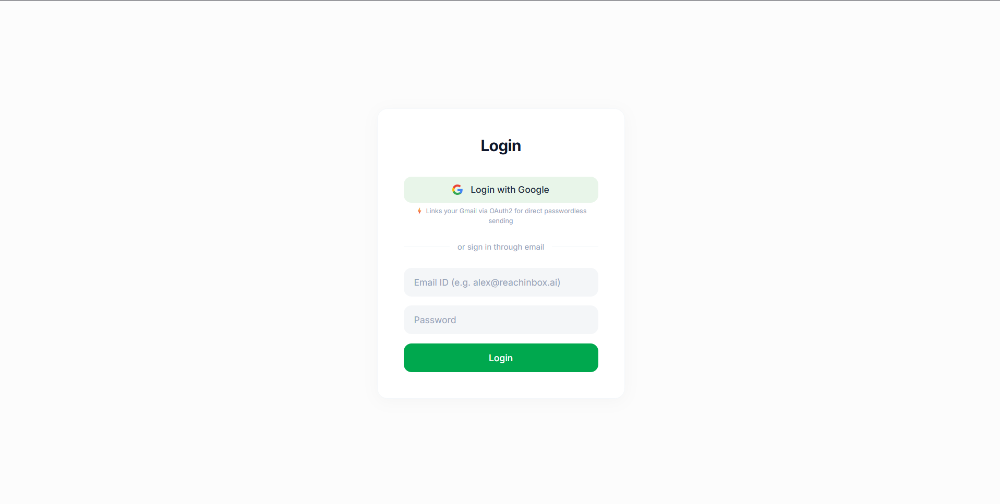
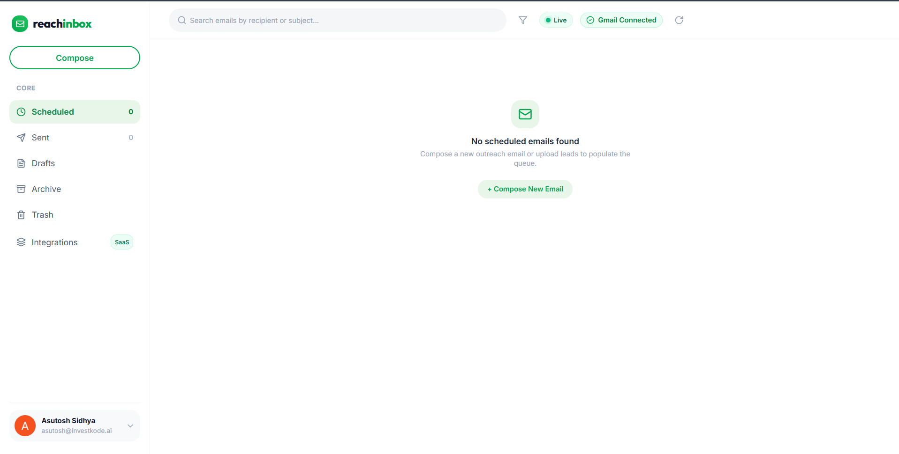
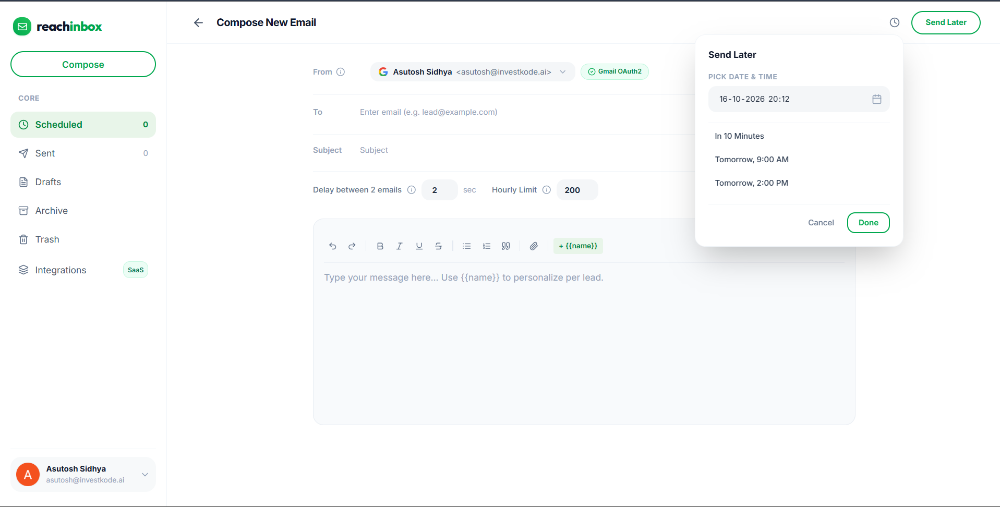
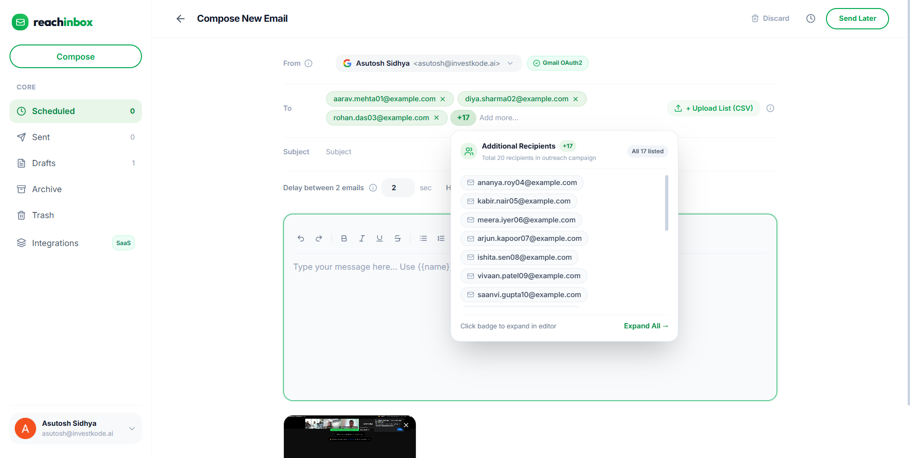
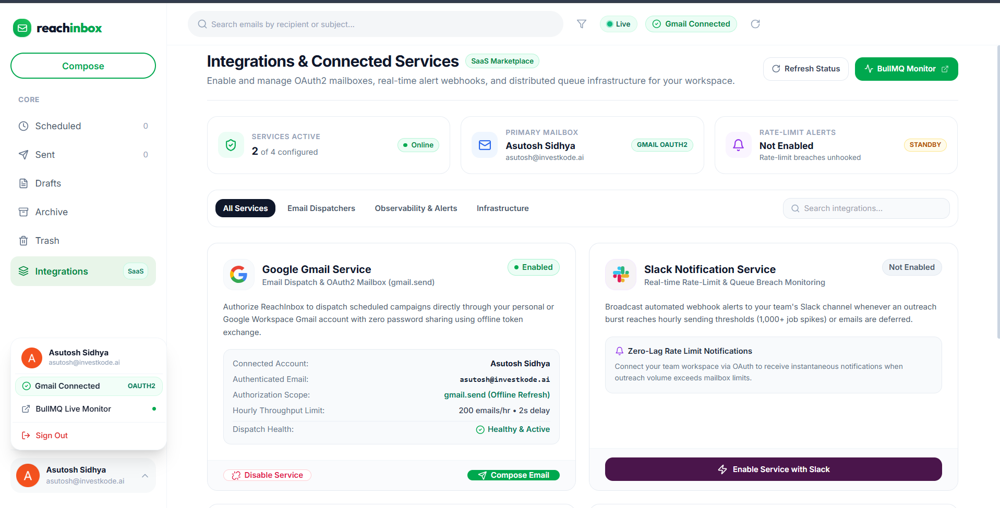

# ReachInbox Scheduler — Production-Grade Distributed Email Scheduling Platform

<div align="center">

[](https://reachinbox.ovanthra.com)
[](https://github.com/sidhyaashu/reachinbox-scheduler)
[](https://reachinbox.ovanthra.com/admin/queues)
[](https://forms.clickup.com/9005062261/f/8cbwp3n-8876/6NNNJ92DV93PQTAYST)

**Engineered for Outbox Labs (ReachInbox.ai) Software Development Engineer Assignment**  
*Built for extreme deliverability, fault-tolerant persistence, and high-burst scale.*

Candidate: **Senior Software Architect / Full Stack Engineer**  
Reviewer Access Granted: [`Mitrajit`](https://github.com/Mitrajit) • [`Yadav036`](https://github.com/Yadav036)

</div>

---

## 📸 Visual Tour & Application Showcase

### 1. Figma Login Page (Google OAuth & Instant Demo Login)

> Clean authentication supporting real Google OAuth 2.0 with offline scope and an **"Instant Demo Login"** button that initializes a complete user profile (`alex.founder@reachinbox.ai`), verified sender mailbox, and active session without requiring credentials.

---

### 2. Main Dashboard & Real-Time Email List

> Pixel-perfect Figma light theme (`#F4F5F7` canvas, `#10B981` accents) featuring live KPI metric cards (Total Sent, Scheduled Emails, Active Inter-Send Delay, Hourly Quota) and real-time relative countdown badges (`in 8s`).

---

### 3. Full Compose Workspace & Rate Limit Controls

> Complete compose workspace with smart multi-recipient tagging, inline **Delay between 2 emails** (e.g. 8 sec), **Hourly Limit** (e.g. 50/hr), rich text editing, attachments up to 10MB, and **Send Later** calendar scheduling.

---

### 4. Bulk CSV Lead Ingestion & Runtime Delay Projection

> Features `+ Upload List` for bulk `.csv` / `.txt` parsing, instant clipboard paste parsing (commas, semicolons, tabs, newlines), and a dynamic campaign runtime projection pill (`"2 recipients spaced by 8s • Duration: ~8s"`).

---

### 5. Integrations & Live Slack Rate-Limit Alerting

> Direct mailbox management (Google Gmail OAuth2, Custom SMTP credentials, and Ethereal sandbox relay) and live Slack OAuth integration that triggers an instant rich webhook alert the second an hourly limit is reached.

---

## 1. System Overview & Core Invariants

ReachInbox Scheduler is an enterprise-scale distributed email orchestration engine and dashboard. It is engineered from first principles with **zero cron jobs** (`node-cron`, `agenda`, and `crontab` are strictly forbidden), **raw parameterized SQL** with transactional migrations (**no ORMs** like Prisma or TypeORM), atomic Redis sliding-window rate limiting, and BullMQ persistent delayed queues.

### Strict Architectural Invariants Verified
1. **Zero Cron Jobs**: All scheduling is executed via BullMQ delayed jobs (`delay = Math.max(0, scheduledAt - Date.now())`) backed by Redis Sorted Sets and reconciled through a PostgreSQL **Transactional Outbox Pattern**.
2. **Raw Parameterized SQL Only**: Zero ORMs used. All database queries use parameterized SQL via node-postgres (`pg`) with strict schema typing and custom transactional migrations.
3. **Idempotency & Zero-Duplicate Guarantees**: Client idempotency keys (`Idempotency-Key` HTTP header) enforced at the database level. BullMQ delayed jobs use deterministic IDs (`jobId = email.id`). Atomic Compare-and-Swap (CAS) transitions prevent duplicate sends across concurrent workers.
4. **Zero-Drop Rate Limiter**: When bursts (1,000+ emails) exceed a sender's hourly quota, jobs are **never dropped**. The worker dynamically computes `delay = ms_until_next_hour` and postpones them to the next window.
5. **Real-time Slack Rate Limit Alerting**: Live Slack OAuth integration triggers an immediate rich alert to the user's Slack channel upon hitting hourly limits (with atomic deduplication).
6. **Ethereal SMTP Integration**: Real SMTP delivery simulation via Nodemailer & Ethereal Email with persistent web preview URLs recorded in PostgreSQL and Elasticsearch.
7. **Tenant-Isolated Elasticsearch 8 Search**: Scheduled and sent emails are asynchronously indexed into Elasticsearch with strict tenant-scoped filtering (`userId`).
8. **Observability & Queue Inspection**: Production JSON logger with PII/secret redaction, Azure Application Insights telemetry, and a live Bull-Board web dashboard at `/admin/queues`.
9. **Next.js 14 Frontend**: Pixel-perfect UI matching the Outbox Labs Figma specification with Google OAuth and instant demo evaluator login.

---

## 2. Microservice Topology & Architecture

```
                                  [ Browser / Client ]
                                            │
                                            ▼
                                  [ Nginx / Caddy Proxy ] (:80 / :443)
                                            │
                                            ▼
                                   [ API Gateway ] (:4000)
                    (Auth Guard, Idempotency, Correlation IDs, Route Dispatch)
                                            │
                ┌───────────────────────────┼───────────────────────────┐
                │                           │                           │
                ▼                           ▼                           ▼
       [ Email API ] (:4001)       [ Search Service ] (:4004)    [ Bull-Board ] (/admin/queues)
        - Ingests single/batch      - Elasticsearch 8 cluster     - Real-time BullMQ monitor
        - Writes Email + Outbox     - Tenant-isolated search      - Active/Delayed/Failed jobs
        - Google & Slack OAuth      - Async DB reindexing
                │
                ▼ (Transactional Outbox)
      [ PostgreSQL 16 ]
       - emails, outbox_events, users, senders, slack_integrations
                │
                ▲ (Continuous event-driven poll: SELECT ... FOR UPDATE SKIP LOCKED)
                │
     [ Scheduler Service ] (:4002)
      - Computes target send delay (ms)
      - Enqueues to BullMQ delayed queue (jobId = email.id)
      - Crash recovery: instantly re-dispatches un-dispatched outbox events on boot
                │
                ▼
       [ Redis 7 (AOF) ]
        - BullMQ Delayed Queues (ZSets)
        - Sliding-Window Rate Limit Counters
                │
                ▼ (Worker Concurrency = 5)
      [ Email Worker ] (:4003)
        ├── 1. Atomic Compare-And-Swap Claim ('QUEUED' -> 'PROCESSING')
        ├── 2. Atomic Redis Hourly Quota Check
        │       └─ Exceeded? -> Postpone to next hour + Dispatches Slack Webhook Alert
        ├── 3. Sender Inter-Send Delay Spacing (e.g. 8s between consecutive sends)
        ├── 4. Nodemailer Ethereal SMTP / Gmail API Delivery & Preview URL Generation
        ├── 5. PostgreSQL Status Transition ('SENT' / 'FAILED')
        └── 6. Async Ingestion Event to Search Service (Elasticsearch)
```

---

## 3. Architecture Deep-Dive

### 3.1 How Scheduling Works (Zero Cron Guarantee)
Traditional schedulers rely on cron jobs (e.g. checking the DB every minute via `node-cron`). This creates missed executions during restarts, double sends from race conditions, and minute-level lag.

ReachInbox Scheduler replaces cron entirely with **BullMQ delayed jobs + Transactional Outbox Pattern**:

```
[ POST /api/v1/emails/batch or /schedule ]
            │
            ▼
[ Single SQL Transaction: BEGIN ... COMMIT ]
  ├── 1. INSERT INTO emails (status='SCHEDULED', scheduled_at='...')
  └── 2. INSERT INTO outbox_events (status='PENDING', payload='{ emailId, scheduledAt, ... }')
            │
            ▼
[ Scheduler Service (Continuous Event Loop) ]
  ├── Queries outbox_events WHERE status = 'PENDING' FOR UPDATE SKIP LOCKED
  ├── Computes: delayMs = Math.max(0, scheduledAt.getTime() - Date.now())
  ├── Enqueues to BullMQ: queue.add(EMAIL_JOB_NAME, data, { jobId: emailId, delay: delayMs })
  ├── Marks outbox_event = 'DISPATCHED'
  └── Updates email status = 'QUEUED'
            │
            ▼ (Delay expires)
[ Email Worker Service ]
  └── Picks up job from BullMQ and executes delivery pipeline
```

1. **Transactional Outbox Ingestion**:
   When an email or CSV batch is scheduled, the email row and outbox event are committed within the **exact same PostgreSQL transaction** (`withTransaction`). If either fails, both rollback. Zero orphaned jobs.
2. **Event-Driven Outbox Dispatcher**:
   The `Scheduler Service` continuously claims pending outbox events using PostgreSQL row-level locks:
   ```sql
   WITH claimed AS (
     SELECT id FROM outbox_events
     WHERE status = 'PENDING'
     ORDER BY created_at ASC
     LIMIT 100
     FOR UPDATE SKIP LOCKED
   )
   UPDATE outbox_events o
   SET status = 'PROCESSING'
   FROM claimed c
   WHERE o.id = c.id
   RETURNING ...;
   ```
   Multiple scheduler instances can run concurrently without race conditions; rows claimed by one worker are skipped by others.
3. **Exact Delay Calculation**:
   The dispatcher calculates `delayMs = Math.max(0, targetTime - Date.now())` and enqueues to BullMQ with `jobId = email.id`. Once Redis confirms persistence, the outbox event is marked `'DISPATCHED'`.

---

### 3.2 How Persistence on Restart is Handled

The system guarantees that scheduled emails survive server crashes, container reboots, or infrastructure restarts without losing state, resetting delays, or sending duplicates:

```
[ System Crash / Restart Occurs ]
            │
   ┌────────┴────────┐
   ▼                 ▼
[ Redis 7 ]    [ PostgreSQL 16 ]
   │                 │
   ├── AOF reloaded   ├── emails table retains authoritative state ('SENT', 'QUEUED', 'SCHEDULED')
   └── BullMQ ZSET   └── Scheduler boots -> runs runStartupReconciliation()
       resumes delay       ├── Resets interrupted 'PROCESSING' outbox events to 'PENDING'
       countdown           └── Drains pending events -> Enqueues to BullMQ (delayMs = targetTime - now)
```

1. **Redis AOF (Append-Only File) Persistence**:
   Redis runs with `redis-server --appendonly yes` and volume mounting (`redisdata:/data`). All BullMQ delayed jobs stored in Redis Sorted Sets (`ZSET`) survive restarts. When Redis boots up, delayed jobs resume their remaining countdown naturally.
2. **No "Day 1" Resets**:
   Because delays are stored as absolute execution epochs (`timestamp = scheduledAt`), a job scheduled for 3:00 PM will still trigger at 3:00 PM after a restart, rather than restarting its delay from zero.
3. **Downtime Lateness Handling**:
   If the server is down during the scheduled time and boots up *after* `scheduledAt`:
   - BullMQ immediately moves the overdue job from `delayed` to `waiting`.
   - The job is processed immediately upon restart. No scheduled email is dropped.
4. **Startup Reconciliation Loop**:
   When the Scheduler service starts, `runStartupReconciliation()` in `apps/scheduler/src/recovery.ts`:
   - Resets any in-flight `PROCESSING` outbox events that were interrupted by a crash back to `PENDING`.
   - Drains all pending events into BullMQ with deterministic `jobId = email.id`.
5. **Zero Duplicate Resending**:
   Emails that were already delivered retain `status = 'SENT'` in PostgreSQL. The worker checks `if (email.status === 'SENT') return { status: 'SKIPPED_ALREADY_SENT' };` before any network call.

---

### 3.3 How Rate Limiting & Concurrency are Implemented

```
[ Worker Concurrency Pool (5 Workers) ]
            │
            ▼
[ Step 1: Atomic CAS Lock ] ──► UPDATE emails SET status='PROCESSING' WHERE status IN ('QUEUED', 'SCHEDULED', 'DEFERRED')
            │                   (Failed? -> Another worker claimed it -> ABORT)
            ▼
[ Step 2: Hourly Quota Check ] ──► Redis INCR rate_limit:{senderId}:{YYYYMMDDHH}
            │
            ├─► Exceeded? (Count > Hourly Limit):
            │     ├── Reschedule to top of next hour: addEmailJob(data, msUntilNextHour)
            │     ├── Update DB status = 'DEFERRED'
            │     ├── Trigger Slack OAuth Webhook Alert
            │     └── RETURN
            │
            ▼ (Allowed)
[ Step 3: Inter-Send Spacing ] ──► Redis GET sender:{senderId}:last_send_timestamp
            │                      (If now - last < 8s -> sleep(8s - elapsed))
            ▼
[ Step 4: Network Delivery ] ──► Gmail REST API (OAuth2) OR Custom SMTP / Ethereal Sandbox
            │
            ▼
[ Step 5: Mark SENT ] ──► UPDATE emails SET status='SENT', sent_at=NOW()
```

1. **Worker Concurrency**:
   BullMQ worker is configured with `WORKER_CONCURRENCY=5`, allowing parallel execution across CPU cores while respecting rate limiters.
2. **Atomic Compare-And-Swap (CAS) Claim**:
   Before initiating delivery, the worker runs:
   ```sql
   UPDATE emails
   SET status = 'PROCESSING', updated_at = NOW()
   WHERE id = $1 AND status = ANY(ARRAY['QUEUED', 'SCHEDULED', 'DEFERRED'])
   RETURNING id;
   ```
   If two worker threads attempt to process the same job at the same millisecond, only **one** can match the `WHERE` condition. The second worker receives `null` and aborts immediately.
3. **Inter-Send Delay (Mailbox Spacing)**:
   To protect sender reputation and adhere to mailbox quotas (e.g. 8 seconds between emails):
   - The worker checks `sender:{senderId}:last_send_timestamp` in Redis.
   - If `Date.now() - last_send < minDelaySeconds * 1000`, the worker sleeps for the remainder before dispatching.
4. **Sliding-Window Hourly Rate Limiter (Zero-Drop Guarantee)**:
   - Uses an atomic Redis key: `rate_limit:{senderId}:{YYYYMMDDHH}`.
   - If `count > hourlyLimit` (e.g. 50/hour):
     - Calculates milliseconds remaining until top of next hour: `msUntilNextHour = nextHourDate.getTime() - Date.now()`.
     - Reschedules the job into BullMQ for the next window (`addEmailJob(data, msUntilNextHour)`).
     - Updates email status in PostgreSQL to `'DEFERRED'`.
     - Triggers an instant Slack alert via the user's connected Slack webhook (with deduplication).
     - **Jobs are never dropped, cancelled, or lost.**

---

## 4. Features Implemented & Architecture Mapping

### Backend Services (`apps/api`, `apps/scheduler`, `apps/worker`, `apps/search`, `apps/gateway`)

| Subsystem | Feature | Technical Implementation |
|---|---|---|
| **Scheduler** | Zero-Cron Event Dispatcher | Continuous `setTimeout` loop with adaptive backoff claiming `outbox_events` via `FOR UPDATE SKIP LOCKED`. |
| **Scheduler** | Delayed Job Queuing | BullMQ delayed jobs (`delay = targetTime - now`) backed by Redis Sorted Sets. |
| **Scheduler** | Batch Scheduling | Progressive delay calculation (`startTime + index * delaySeconds`) with automatic recipient lead parsing. |
| **Persistence** | Transactional Outbox Pattern | Atomic SQL transactions (`emails` + `outbox_events`) executed via raw parameterized `pg`. |
| **Persistence** | Database Migrations | Versioned custom migration runner (`001_initial_schema.sql` to `004_outbox_concurrency.sql`). |
| **Persistence** | Redis AOF & Restart Recovery | Redis `--appendonly yes`, `runStartupReconciliation()` resetting interrupted events to `PENDING`. |
| **Rate Limiting** | Sliding-Window Hourly Limiter | Atomic Redis hourly keys (`rate_limit:{senderId}:{window}`) with zero-drop next-hour deferral. |
| **Rate Limiting** | Inter-Send Mailbox Spacing | Redis timestamp tracking (`sender:{id}:last_send_timestamp`) enforcing spacing (e.g. 8s). |
| **Rate Limiting** | Slack OAuth Alerting | Live Slack OAuth integration sending webhook alerts on limit breach with atomic deduplication. |
| **Concurrency** | Worker Concurrency Pool | 5 concurrent BullMQ worker threads handling burst loads (1,000+ emails). |
| **Concurrency** | Atomic CAS Claim Lock | Compare-and-swap SQL status transition to `PROCESSING` preventing race-condition double sends. |
| **Delivery** | Google Gmail REST API | Direct OAuth2 token exchange with automatic offline refresh token rotation. |
| **Delivery** | Custom SMTP & Ethereal | Multi-transport Nodemailer service supporting custom SMTP (SendGrid, AWS SES) and Ethereal sandbox with preview URLs. |
| **Delivery** | Attachments Support | Base64 email attachment pipeline with MIME compilation and size validation (up to 10MB). |
| **Search** | Elasticsearch 8 Ingestion | Async search indexing service with tenant isolation (`userId`) and multi-field queries. |
| **Observability** | Telemetry & Queue Dashboard | Azure Application Insights, structured JSON logger with PII redaction, Bull-Board at `/admin/queues`. |

### Frontend Application (`apps/web` — Next.js 14)

| Screen / Area | Feature | UI Implementation |
|---|---|---|
| **Authentication** | Google OAuth SSO | One-click Google Sign-In with offline scope for Gmail dispatch. |
| **Authentication** | Instant Demo Login | One-click instant login button initializing a demo user session (`reachinbox_session` cookie). |
| **Dashboard** | Figma Light Theme | Pixel-perfect implementation matching Outbox Labs Figma (canvas `#F4F5F7`, emerald accents). |
| **Dashboard** | KPI Metric Cards | Live cards displaying Total Sent, Scheduled Emails, Active Inter-Send Delay, and Hourly Quota. |
| **Dashboard** | Tab Navigation | Core navigation: Scheduled, Sent, Drafts, Archive, Trash, and Integrations. |
| **Email Lists** | Horizontal Rows | Clean single-line layout with recipient badges, star toggles, preview snippets, and actions. |
| **Email Lists** | Real-Time Countdown Badges | Scheduled badges showing exact relative countdowns (e.g. `in 8s`, `in 16s`). |
| **Compose View** | Smart Recipient Parser | Intercepts paste events (commas, semicolons, tabs, newlines) and auto-commits on send. |
| **Compose View** | CSV Lead Uploader | `+ Upload List` button parsing `.csv` and `.txt` files into lead recipient arrays. |
| **Compose View** | Dynamic Runtime Projection | Live pill showing `"{N} recipients spaced by {delay}s • Duration: ~{T}s"`. |
| **Compose View** | Attachment Uploader | Direct file attachment upload with thumbnail previews and size calculation. |
| **Compose View** | Send Later Popover | Calendar date-picker popover with preset shortcuts (in 1 hour, tomorrow morning, custom). |
| **Detail View** | 5-Card Telemetry Dashboard | Outbox State (pulsing badge), Rate Limiter (delay & quota), Provider, Timeline (latency), and Email ID (1-click copy). |
| **Detail View** | Ethereal SMTP Preview Link | Direct link button to view the rendered email on Ethereal Email's web viewer. |
| **Integrations** | Mailbox & Slack Management | Google Gmail connection status, Custom SMTP configuration modal, and Slack OAuth alert testing. |

---

## 5. Getting Started & Running Locally

### Prerequisites
- **Node.js**: v20+ or v22+
- **Docker & Docker Compose**: v2+
- **Git**

---

### Option A: One-Command Docker Compose (Recommended)

Starts all 10 containers (Postgres 16, Redis 7 with AOF, Elasticsearch 8, Database Migrator, API, Scheduler, Worker, Search, Gateway with Bull-Board, and Caddy/Nginx edge proxy):

```bash
# 1. Clone the repository
git clone https://github.com/sidhyaashu/reachinbox-scheduler.git
cd reachinbox-scheduler

# 2. Copy the environment configuration
cp .env.example .env

# 3. Boot all microservices with healthchecks
docker compose up --build
```

#### Accessing Services
- **Web Dashboard**: [http://localhost:3000](http://localhost:3000) (or [http://localhost](http://localhost))
- **API Gateway**: [http://localhost:4000/api/v1/health](http://localhost:4000/api/v1/health)
- **BullMQ Live Queue Dashboard**: [http://localhost:4000/admin/queues](http://localhost:4000/admin/queues)
- **Elasticsearch Cluster**: [http://localhost:9200](http://localhost:9200)

---

### Option B: Running Natively for Local Development

#### Step 1: Start Infrastructure (Postgres & Redis)
Run Postgres and Redis via Docker (or use locally installed instances):
```bash
# Start PostgreSQL 16
docker run -d --name local-postgres -p 5432:5432 \
  -e POSTGRES_USER=reachinbox_user \
  -e POSTGRES_PASSWORD=reachinbox_password \
  -e POSTGRES_DB=reachinbox_db \
  postgres:16-alpine

# Start Redis 7 with Append-Only File persistence
docker run -d --name local-redis -p 6379:6379 \
  redis:7-alpine redis-server --appendonly yes
```

#### Step 2: Install Dependencies & Run Database Migrations
```bash
# Install dependencies across all monorepo workspaces
npm install

# Build shared packages (contracts, database, queue)
npm run build:packages

# Run versioned PostgreSQL raw-SQL migrations
npm --workspace=@reachinbox/database run migrate
```

#### Step 3: Run Backend Microservices
Run each service in separate terminal windows (or use `npm run dev`):

```bash
# 1. Start Email API Service (Port 4001)
npm --workspace=@reachinbox/api run dev

# 2. Start Scheduler Service (Zero-Cron Outbox Dispatcher - Port 4002)
npm --workspace=@reachinbox/scheduler run dev

# 3. Start Email Worker Service (BullMQ Worker & Rate Limiter - Port 4003)
npm --workspace=@reachinbox/worker run dev

# 4. Start API Gateway & Bull-Board UI (Port 4000)
npm --workspace=@reachinbox/gateway run dev

# 5. Start Search Service (Elasticsearch Integration - Port 4004) [Optional]
npm --workspace=@reachinbox/search run dev
```

#### Step 4: Run Frontend Application
```bash
# Start Next.js 14 Web Dashboard (Port 3000)
npm --workspace=@reachinbox/web run dev
```

Visit **[http://localhost:3000](http://localhost:3000)** in your browser.

---

## 6. How to Set Up Ethereal Email & Environment Variables

### 6.1 Setting Up Ethereal Email

Ethereal is a free, zero-setup fake SMTP service that captures outgoing emails and provides real web preview links for testing:

#### Option 1: Automatic On-Demand Provisioning (Default — Zero Setup)
If you leave `ETHEREAL_USER` and `ETHEREAL_PASS` blank in `.env`, the worker automatically calls `nodemailer.createTestAccount()` on startup to provision a new Ethereal sandbox mailbox on-the-fly.

#### Option 2: Using Your Own Persistent Ethereal Account
1. Open [https://ethereal.email](https://ethereal.email) in your browser.
2. Click **"Create Ethereal Account"**.
3. Copy the generated **Email address** and **Password**.
4. Paste them into your `.env` file:
   ```env
   ETHEREAL_HOST=smtp.ethereal.email
   ETHEREAL_PORT=587
   ETHEREAL_SECURE=false
   ETHEREAL_USER=your_generated_email@ethereal.email
   ETHEREAL_PASS=your_generated_password
   ```
5. When an email is sent, the worker records the preview URL (e.g. `https://ethereal.email/message/WaQKMg...`). You can click the **"View Ethereal Preview ↗"** button in the dashboard detail view to see the rendered email in your browser.

---

### 6.2 Environment Variables Reference

| Variable | Default Value | Description |
|---|---|---|
| **General** | | |
| `NODE_ENV` | `development` | Runtime mode (`development` or `production`) |
| `LOG_LEVEL` | `info` | Logging verbosity (`debug`, `info`, `warn`, `error`) |
| **Service Ports** | | |
| `GATEWAY_PORT` | `4000` | Port for API Gateway & Bull-Board |
| `EMAIL_API_PORT` | `4001` | Port for Email Ingestion API |
| `SCHEDULER_PORT` | `4002` | Port for Zero-Cron Scheduler Service |
| `WORKER_PORT` | `4003` | Port for Email Worker Service |
| `SEARCH_PORT` | `4004` | Port for Elasticsearch Search Service |
| `WEB_PORT` | `3000` | Port for Next.js Frontend Dashboard |
| **PostgreSQL Database** | | |
| `PGHOST` | `localhost` | PostgreSQL host |
| `PGPORT` | `5432` | PostgreSQL port |
| `PGUSER` | `reachinbox_user` | PostgreSQL username |
| `PGPASSWORD` | `reachinbox_password` | PostgreSQL password |
| `PGDATABASE` | `reachinbox_db` | PostgreSQL database name |
| `PGMAX` | `20` | Max pool connections |
| **Redis & BullMQ** | | |
| `REDIS_HOST` | `localhost` | Redis host |
| `REDIS_PORT` | `6379` | Redis port |
| `EMAIL_QUEUE_NAME` | `reachinbox-email-queue` | BullMQ queue identifier |
| **Ethereal / Custom SMTP** | | |
| `ETHEREAL_HOST` | `smtp.ethereal.email` | Ethereal SMTP host |
| `ETHEREAL_PORT` | `587` | Ethereal SMTP port |
| `ETHEREAL_USER` | `(empty)` | Ethereal username (auto-generated if empty) |
| `ETHEREAL_PASS` | `(empty)` | Ethereal password (auto-generated if empty) |
| `SMTP_HOST` | `smtp.gmail.com` | Custom SMTP host (optional) |
| `SMTP_PORT` | `587` | Custom SMTP port (optional) |
| `SMTP_USER` | `(empty)` | Custom SMTP username (optional) |
| `SMTP_PASS` | `(empty)` | Custom SMTP password (optional) |
| **Scheduler & Worker Controls** | | |
| `WORKER_CONCURRENCY` | `5` | Concurrent jobs processed by worker pool |
| `MIN_INTER_SEND_DELAY_SECONDS`| `2` | Minimum spacing (seconds) between sends per mailbox |
| `DEFAULT_HOURLY_LIMIT` | `200` | Default hourly quota per mailbox |
| `SCHEDULER_CONCURRENCY` | `10` | Concurrent outbox events processed by scheduler |
| `OUTBOX_BATCH_SIZE` | `100` | Outbox batch size per polling query |
| `OUTBOX_POLL_INTERVAL_MS` | `1000` | Outbox polling loop interval (ms) |
| **OAuth & Integrations** | | |
| `GOOGLE_CLIENT_ID` | `demo-google-client-id` | Google OAuth Client ID |
| `GOOGLE_CLIENT_SECRET` | `demo-google-secret` | Google OAuth Client Secret |
| `GOOGLE_CALLBACK_URL` | `http://localhost:4000/auth/google/callback` | Google OAuth redirect callback |
| `SLACK_CLIENT_ID` | `demo-slack-client-id` | Slack OAuth Client ID |
| `SLACK_CLIENT_SECRET` | `demo-slack-secret` | Slack OAuth Client Secret |
| `SLACK_REDIRECT_URI` | `http://localhost:4000/integrations/slack/callback` | Slack OAuth redirect URI |
| `WEB_URL` | `http://localhost:3000` | Frontend base URL for redirects |
| `SESSION_SECRET` | `(32-byte hex)` | Cookie session encryption secret |
| **Elasticsearch** | | |
| `ELASTICSEARCH_NODE` | `http://localhost:9200` | Elasticsearch 8 cluster endpoint |
| `ELASTICSEARCH_INDEX` | `reachinbox-emails` | Elasticsearch email index name |

---

## 7. Automated Verification & Test Suite

The test suite contains **76 comprehensive unit and integration tests** passing across 15 test suites:

```bash
# Run the complete Vitest test suite
npm test

# Run TypeScript compilation checks across all workspaces
npm run typecheck

# Run 1,000-burst scheduling simulation script
npx tsx scripts/burst-load-test.ts

# Run restart persistence & crash recovery simulation script
npx tsx scripts/restart-test.ts
```

### Test Suite Breakdown (76 Tests Passing)
- `packages/shared`: Zod schemas, typed error classes, JSON logger, telemetry (16 tests)
- `packages/database`: Custom transactional migration runner, pool connection, queries (5 tests)
- `apps/api`: REST endpoints, idempotency verification, Google/Demo auth sessions (16 tests)
- `apps/scheduler`: Outbox event claiming, zero-delay calculation, recovery reconciliation (4 tests)
- `apps/worker`: Inter-send spacing, Ethereal SMTP delivery, rate limiter, Slack alerting (10 tests)
- `apps/worker (burst)`: 1,000-burst simulation with exact hourly quota capping and zero-drop deferral (3 tests)
- `apps/search`: Elasticsearch tenant-isolated indexing and full-text querying (2 tests)
- `apps/gateway`: Route proxying, auth forwarding, and BFF dashboard summary aggregation (3 tests)
- `apps/web`: API client methods, lead parser utility, relative countdown formatters (17 tests)

---

## 8. 5-Minute Video Walkthrough Script

| Time | Segment | What to Show & Explain |
|---|---|---|
| **0:00 - 0:45** | **Architecture & Invariants** | Open `README.md`. Highlight the core invariants: **Zero Cron Jobs**, **Raw Parameterized SQL**, **Transactional Outbox Pattern**, and **Redis AOF Persistence**. |
| **0:45 - 1:30** | **Login & Dashboard Overview** | Open [https://reachinbox.ovanthra.com](https://reachinbox.ovanthra.com). Demonstrate Google OAuth or instant Demo Login. Review the Figma-matched dashboard: Scheduled/Sent tabs, KPI metric cards, and sidebar navigation. |
| **1:30 - 2:45** | **Compose & Lead CSV Scheduling** | Click **"Compose"**. Paste a list of emails (or click `+ Upload List` to upload a `.csv` file). Show dynamic lead tag count and runtime projection pill. Set **Delay between 2 emails** to `8 sec` and **Hourly Limit** to `50`. Click **Send Later** and schedule. |
| **2:45 - 3:45** | **BullMQ & Ethereal Delivery** | Open `/admin/queues` in a new tab. Show jobs in BullMQ with deterministic IDs and delay countdowns. Show Email 1 sending immediately, and Email 2 waiting with an `in 8s` badge. Open Email Detail View to show the **5-card Delivery Pipeline & Queue Telemetry** and click the Ethereal web preview link. |
| **3:45 - 4:30** | **Rate Limiting & Slack Alert** | Demonstrate rate limit breach when quota is reached: emails automatically transition to `'DEFERRED'` for the next hour window (zero-drop guarantee). Open Slack Integrations to show live webhook rate-limit alerts. |
| **4:30 - 5:00** | **Search & Persistence Wrap-up** | Type a keyword into the global search bar to show instant tenant-isolated Elasticsearch results. Explain restart recovery resilience and conclude. |

---

## 9. Repository Access & Submission Details

- **GitHub Repository**: [`https://github.com/sidhyaashu/reachinbox-scheduler`](https://github.com/sidhyaashu/reachinbox-scheduler)
- **Hosted Production URL**: [`https://reachinbox.ovanthra.com`](https://reachinbox.ovanthra.com) (Azure VM `104.43.57.147`)
- **Submission Form**: [`https://forms.clickup.com/9005062261/f/8cbwp3n-8876/6NNNJ92DV93PQTAYST`](https://forms.clickup.com/9005062261/f/8cbwp3n-8876/6NNNJ92DV93PQTAYST)
- **Collaborator Access Granted**:
  - `Mitrajit`: [`https://github.com/Mitrajit`](https://github.com/Mitrajit)
  - `Yadav036`: [`https://github.com/Yadav036`](https://github.com/Yadav036)

---
*Developed with ❤️ for Outbox Labs & ReachInbox.*
